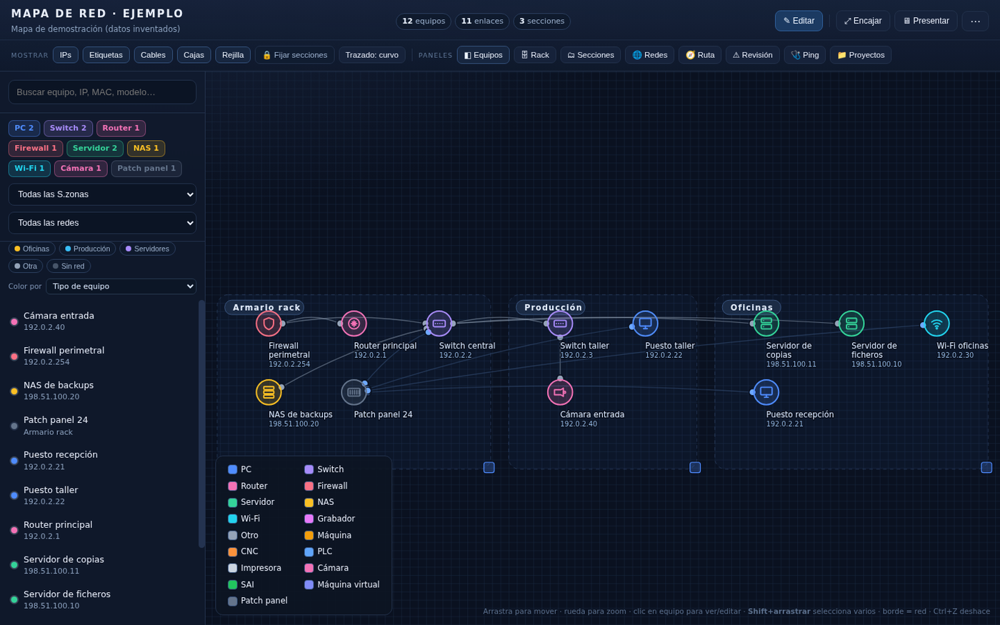
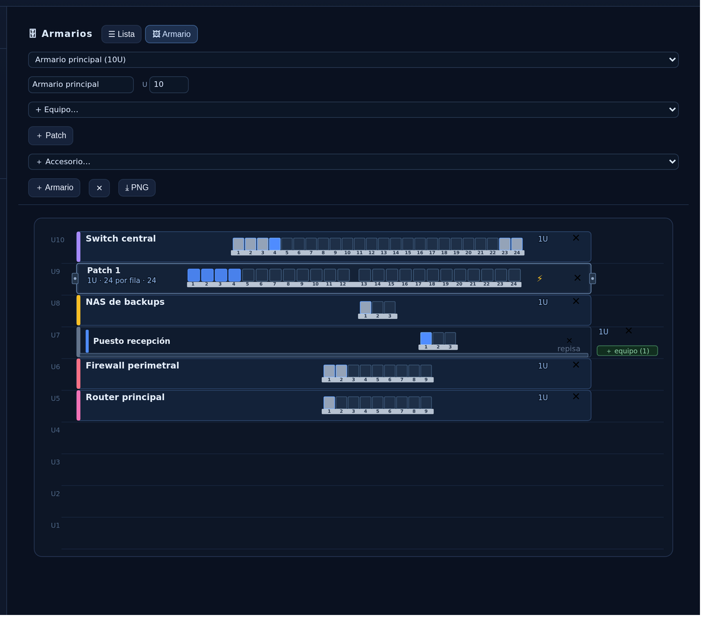
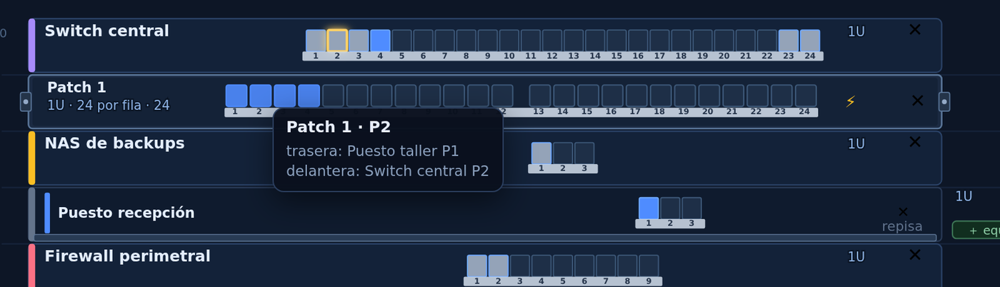
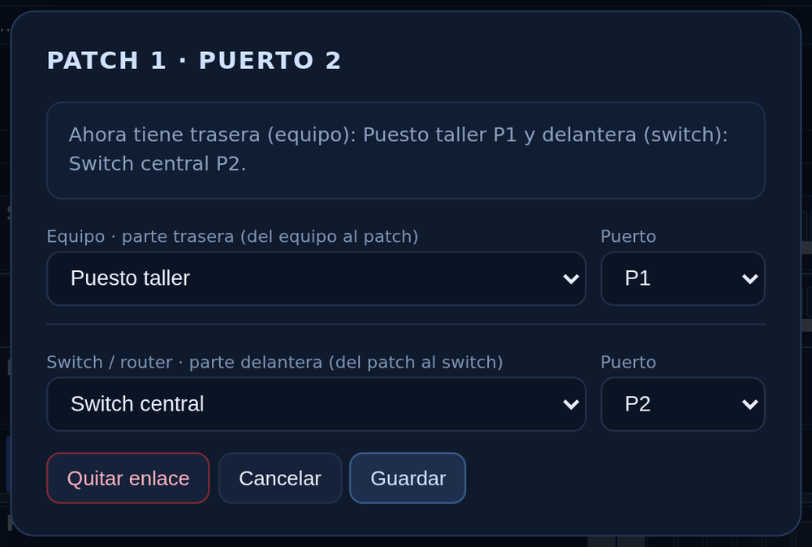
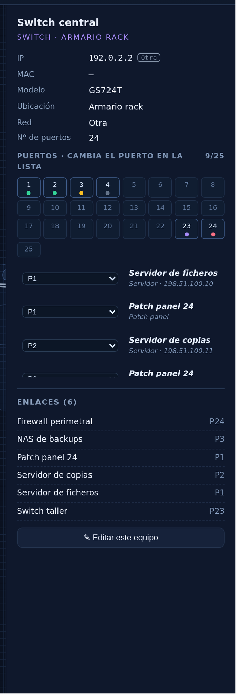

# Editor de mapas de red

Editor de mapas de red en **un único archivo HTML**, sin dependencias ni instalación. Funciona en cualquier navegador y guarda los proyectos **en el propio navegador**.

**▶ App publicada:** https://alfajes.github.io/editor-mapas-red/



> Las capturas usan un mapa de demostración con datos inventados (IPs de documentación `192.0.2.x` y `198.51.100.x`).

## Capturas

**Armario / rack realista** — filas U configurables por armario, equipos en cualquier posición, patch panels, bandejas y accesorios.



**Puertos con información al pasar el ratón** — cada puerto dice a dónde va y se resalta el puerto del otro extremo.



**Patch panel de dos caras** — por cada puerto, la parte trasera (del equipo al patch) y la delantera (del patch al switch o router).



**Ficha del equipo** — IPs en varias redes, MAC, modelo, puertos con su estado y la lista de enlaces.



## Qué incluye

- Equipos con nombre, IP (varias, incluso en subredes distintas), MAC, modelo, ubicación, SO, puertos, periféricos y notas.
- 16 tipos de equipo con icono y color propios: PC, switch, router, firewall, servidor, NAS, Wi-Fi, grabadora, máquina, CNC, PLC, impresora, cámara, SAI, **patch panel** y otro.
- **Zonas o secciones**: crear, renombrar, redimensionar, mover, anidar (zona padre), bloquear y borrar.
- **Enlaces** entre equipos con puerto en cada extremo, color propio, etiqueta, categoría de cable, visibilidad y trazado curvo / recto / ortogonal con varios puntos de control.
- **Cambiar a qué está conectado cualquier equipo** (no solo switches): desde la ficha del equipo (⇄ en cada enlace), desde el cable («⇄ Cambiar equipos») o desde el armario. Conserva el trazado del cable y solo modifica el tramo del extremo cambiado.
- **Armarios tipo rack**: filas U configurables por armario, equipos colocables en cualquier posición, patch panels, bandejas de tamaño fijo con equipos dentro y accesorios. Botón ⚡ para enlazar un patch completo al switch con el mismo número de puerto.
- **Patch panel de dos caras**: cada puerto tiene su parte trasera (equipo) y delantera (switch / router); se reflejan como dos cables en el mapa y el puerto se colorea según la conexión.
- **Tooltips por puerto** en el armario: dicen a dónde va cada boca y resaltan el puerto del otro extremo.
- **Cajones de texto y flechas**, movibles; las flechas se anclan a equipos y los siguen.
- **Inventario de puertos** por equipo: tipo, velocidad, nota y qué hay conectado en cada boca.
- Rejilla con ajuste, multiselección, deshacer, búsqueda y filtros por tipo, zona y red.
- **Revisión de inventario**: IPs duplicadas, MACs repetidas, datos que faltan.
- **Exportar** a PNG, PDF (A4 horizontal), JSON y HTML autónomo con los datos dentro.
- Modo presentación para consultar el mapa sin riesgo de editar nada.

## Privacidad y datos

- No hay servidor ni cuentas: cada navegador guarda sus mapas en `localStorage`.
- El repositorio se publica **sin datos**: la app arranca con un mapa vacío.
- Para mover un mapa entre equipos: **⋯ → Guardar copia (HTML)**, que genera un archivo autónomo con el editor y los datos.

## Atajos

- `Ctrl+Z` deshacer · `Supr` borrar el equipo seleccionado
- Rueda: zoom · arrastrar el fondo: desplazar
- Doble clic en el título de una sección: renombrarla
- Shift + arrastrar: seleccionar varios

## Uso local

Abre `index.html` en el navegador. Para que el guardado automático funcione de forma fiable, sírvelo por HTTP:

```bash
python3 -m http.server 8099
```

## Desarrollo

El editor se construye desde `src/` y el resultado es **un único HTML** autosuficiente.

```
src/template.html   estructura (head, cuerpo, diálogos)
src/styles.css      estilos
src/modules/*.js    código en módulos ES (base, modelo, layout, geometría, render, formularios,
                    interacciones, UI, rack, armarios, conexiones, zonas, proyectos, init)
src/data.json       mapa real (NO se publica; está en .gitignore)
build.mjs           empaqueta y minifica en un solo archivo
```

```bash
npm install
npm run build          # dist/mapa.html    (privado, con tus datos)
npm run build:public   # dist/publico.html (vacío, para publicar)
npm run build:all
npm run check          # comprueba el resultado
```

Para desplegar: `dist/publico.html` → `index.html` del repo (GitHub Pages) y del servidor local.

## Licencia

Uso libre para documentar tus propias redes.
